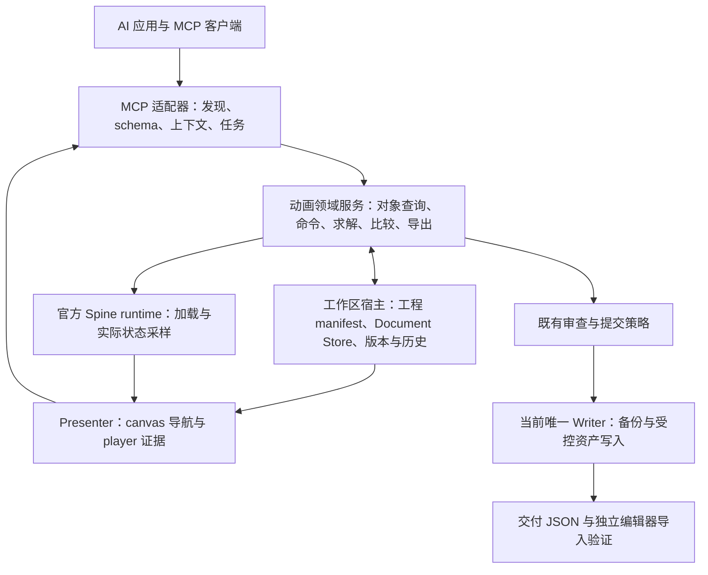

# 成熟 MCP 对标与 Host 架构评估

实施更新（2026-10-21）：建议已经部分落入源码，见 [Host 实施与验收](Host实施与验收-20261021.md)。工程模型、显式能力与快照/命令边界已有实现，完整任务仍受 B2 像素门禁、真实美术与长期观察约束；下文研究结论不等于全部建议已交付。

评估日期：2026-10-21。对象：当前工作树、Host 工单 v1.6 与 L1/L2 工单 v1.2。

后续采纳记录（2026-10-21）：用户已要求将工程 manifest、角色能力/readiness、schema 完备性、共享领域服务及最小单姿态闭环纳入 [Host v1.7 主工单](plans/host-evolution.md)，L1/L2 同步到 v1.3。本文保留当时对 v1.6 的研究与建议作为依据；golden/截图证据分层已于 2026-10-21 单独确认，现行规则见主工单 v1.8 §4.8。计划更新不代表代码能力已实现。

## 1. 结论与评估边界

本项目适合发展为「基于 Spine 官方 runtime 的 AI 动画工作台」：通过 MCP 接收 Agent 的结构化操作，持有明确的工程与编辑状态，提供连续的数值和视觉反馈，输出经过审查的 Spine 动画 JSON，并独立验证编辑器导入。

Host v1.6 正在补这个工作台的会话和事务基础，方向成立。它已经超出增加几个查询接口的范围，需要实现一部分成熟编辑器原本提供的应用内核。完成协议原语补齐和文档事务系统，仍不能单独证明 AI 已能持续制作符合参考的动画；还需要可发现、可操作、可观察、可撤销的最小创作闭环。

本次通过公开文档和源码进行静态对照，未安装或运行外部编辑器 MCP，也未进行相同任务的效率或质量基准测试。外部项目各有版本、缺陷与限制，不把知名度、工具数量或自述的性能倍数当作成熟度证明。引用的是本次可访问的 main 分支与官方页面；正式复现前应固定 tag/commit，不能把可变分支当作长期验收基线。Unity beta 搜索结果仅用于发现资料，下文源码对照使用 main。

## 2. 先分清协议合规与产品能力

MCP 通过初始化协商可选能力；resources、prompts 与 tools 是不同的接口原语。缺少 resources/prompts 不构成「假 MCP」。本项目已使用 MCP SDK、stdio、tools/list、tools/call、Roots 和协议心跳；仓库也有真实客户端的 stdio 测试。因此当前问题主要是应用能力、状态与反馈的组织方式，而不是只有 MCP 名字。补 resources/prompts 有利于上下文获取和流程引导，但不替代创作内核。[依据：MCP 生命周期与能力协商](https://modelcontextprotocol.io/specification/2025-11-25/basic/lifecycle)

术语也应区分：MCP 规范中的 host 是管理模型、客户端连接与上下文的 AI 应用；本计划中的 Host 是动画工程与会话的宿主。建议在后续实施文档中称为「动画工作区宿主」或「Spine 工作台宿主」，图中分别标注，避免把动画后端误认为 MCP 协议的 host。[依据：MCP 架构定义](https://modelcontextprotocol.io/specification/2025-11-25/architecture)

## 3. 外部项目的结构与可借鉴机制

### 3.1 Blender：将操作落在真实创作环境中

`ahujasid/mcp-for-blender` 的 MCP 服务通过连接把命令交给 Blender 插件；插件使用主线程命令队列执行。场景查询、视口观察和 Python 执行面向运行中的 Blender，因而能利用 Blender 已有的数据模型与执行环境。[服务源码](https://github.com/ahujasid/mcp-for-blender/blob/main/src/blender_mcp/server.py)、[插件与命令队列](https://github.com/ahujasid/mcp-for-blender/blob/main/addon.py)

本项目应借鉴「在同一创作状态上操作和观察」这一机制。Spine 当前没有被本项目接入的同等编辑器内 API，不能仅复制外层 socket 或工具名称就获得这些能力。通用代码执行入口也不能照搬：本项目禁止绕过受控 MCP 自由编辑角色 JSON，因此必须提供足够完整的受控操作。

### 3.2 Unity：上下文、就绪状态与工具发现

CoplayDev 的 Unity MCP 将 Python 服务与编辑器插件连接；editor_state 不只返回在线状态，还提供工程/实例、活动场景、编译与刷新、任务、数据陈旧程度及是否适合调用工具的建议。[连接与实例路由](https://github.com/CoplayDev/unity-mcp/blob/main/Server/src/transport/plugin_hub.py)、[editor_state 源码](https://github.com/CoplayDev/unity-mcp/blob/main/Server/src/services/resources/editor_state.py)

其 manage_tools 支持按会话启用工具组，batch_execute 提供批量命令入口，测试工具采用异步任务及状态查询。它们体现了发现能力、减少重复交互和让长任务可观察的组织方式；批量调用并不自动等于原子事务。[工具发现](https://github.com/CoplayDev/unity-mcp/blob/main/Server/src/services/tools/manage_tools.py)、[批量入口](https://github.com/CoplayDev/unity-mcp/blob/main/Server/src/services/tools/batch_execute.py)、[异步测试任务](https://github.com/CoplayDev/unity-mcp/blob/main/Server/src/services/tools/run_tests.py)

本项目最值得学习的是廉价且可信的工程状态、显式目标、按任务暴露能力，以及运行时回读。无需复制其多实例、全部工具或传输层；单工程限制可以保留。

### 3.3 Unreal：传输、工具注册与实际执行分层

Epic 的 Unreal MCP 文档将协议服务与 Toolset Registry/AllToolsets 分开，并提供按需发现工具集的路径。实际编辑操作同步到引擎线程。该官方功能明确标注 Experimental，本文只借鉴其职责划分与发现方式，不将其视为稳定性标杆。[Unreal MCP 官方文档](https://dev.epicgames.com/documentation/en-us/unreal-engine/unreal-mcp-in-unreal-editor)

对本项目的启示是：MCP 接口可以是窄而明确的入口，背后连接统一的动画服务。工具多不等于应用能力完整；协议服务、对象查询、命令执行及验证应有清晰职责，而不应主要靠不断扩大的 server.ts 维持关联。

### 3.4 Godot：文件可读仍然需要实时回读

`satelliteoflove/godot-mcp` 有意利用文本工程文件，同时通过编辑器读取有效节点、动画和当前画面，并区分文件更改后的重载与运行时观察。其文档明确要求修改动画后播放或定位时间检查结果。[Godot 工具说明](https://github.com/satelliteoflove/godot-mcp/blob/main/docs/tools/README.md)

这一案例与 JSON 路线直接相关：可读文件适合互操作，但磁盘内容不自动等于应用已加载的状态。Godot 允许部分直接文件编辑是它的边界选择；本项目继续遵循现有受控写入规则。

### 3.5 综合对照

以下为对上述机制的工程归纳，不是 MCP 协议的强制架构：

| 维度 | 参考项目提供的机制 | 本项目现状 | Host v1.6 / 配套计划 |
|---|---|---|---|
| 操作目标 | 场景、对象、编辑器实例或工程 | 工程登记与路径参数，缺统一活动文档身份 | 完整版本与 activeDoc 已设计 |
| 状态读取 | 活动对象、就绪/忙碌、加载状态 | 预览上下文、连接记录；姿态查询还会重算 | snapshot、廉价 digest 已设计 |
| 动作执行 | 应用 API 或编辑器命令 | JSON 时间线、语义姿态和重定向工具 | Host 操作与内存求解桥接已设计 |
| 可见反馈 | 应用内场景与视口 | 官方 runtime + 离线图/GIF + 浏览器预览 | 完整回放与 player 证据已设计 |
| 局部迭代 | 修改当前对象并立即回读 | 已有局部工具，但常需新路径、多次调用及报告 | 新版本结果与撤销已设计 |
| 长任务 | 就绪状态、任务与回读 | 有 job/manifest/批处理基础，缺统一进度取消 | L1/L2 已列计划 |
| 能力发现 | 明确工具组、对象查询或工具集索引 | 大量工具及共享参数 schema | L1/L2 改进上下文；工具发现仍列后续 |
| 应用内核 | 大量能力由原生编辑器提供 | 本项目自行承担加载、求解、回放及事务 | 正在补齐，不能仅靠预览 UI 承担 |

## 4. Spine 路线的可行性与边界

官方 JSON 文档将其定义为骨架数据的序列化表示；runtime 负责加载及显示，Nonessential 数据并非全部导出。官方也提供 JSON/二进制导入以及 CLI 导入导出路径。这为外部工作台提供了互操作基础，但不等于读取到了编辑器当前选择、未保存改动或完整创作历史。[JSON 格式](https://en.esotericsoftware.com/spine-json-format)、[导入说明](https://en.esotericsoftware.com/spine-import)、[CLI](https://en.esotericsoftware.com/spine-command-line-interface)

官方 runtime 提供加载、渲染与程序化操纵骨架的能力。因此，以现有预览与 runtime 为呈现和采样基础是有依据的；仍需自行建立工程、命令、求解和历史管理。不能从「编辑器封闭」推导为「必须重写 runtime」，也不能从「runtime 可加载」推导为「编辑器导入已通过」。[官方 runtime 说明](https://en.esotericsoftware.com/spine-runtimes)

上述网页用于判断架构与互操作边界，不用其当前示例直接扩展本项目 4.1.24 的可写 timeline schema。版本审查继续以现有适配、官方格式审查及实际导入验证为准。

### 4.1 必须保留的 2D 特性

| 特性 | 对工作台的要求 | 当前基础 |
|---|---|---|
| 骨骼原点与可见关节不等价 | 读取实际切片/顶点，保存视觉锚点依据 | visualRig 已实现候选、校准与审查 |
| drawOrder 和附件决定遮挡 | 与骨骼姿态一起回放、比较和导出 | frame.presentation 已有实现 |
| 视角依赖已有切片 | 可查询可表达的视角，缺资源时说明原因 | viewProfiles/actionSemantics 已有门禁 |
| 解剖左右与屏幕左右不同 | 稳定身份与逐阶段对应，禁止临时交换 | sequence 与参考记录已有规则 |
| 脚底/手部接触有切片偏移 | 语义目标与校准 anchor/gripPoint 分开 | IK、接触与持杖约束已有实现 |
| 短时动作及连续补间 | 既看关键姿态，也采样完整时间段 | 稀疏姿态、runtime 采样及 GIF 已有基础 |
| 参考匹配有主观与不可知部分 | 数值、实际画面、编辑器导入分别报告 | 已有分层门禁；真实角色验收尚未完成 |

把这些能力保留下来，比模仿通用 3D transform 工具更有价值。2D 角色的可见结果由骨骼、切片状态和层序共同决定，单纯追求节点坐标一致会遗漏核心差异。

## 5. 当前代码的实际状态

| 观察 | 源码证据 | 评估 |
|---|---|---|
| 已有实际 MCP 服务与协议测试 | `src/server.ts`，`test/mcpWorkflow.test.ts` | 应承认已有基础，后续是应用能力升级 |
| 查询与计算尚未分离 | `src/poseOps.ts:getPoseState/explainPose` 调用 solvePoseData | 查询成本、新鲜度和正式判定语义需分清 |
| 每次加载重新建立 runtime | `src/motionRuntime.ts:loadMotionRuntime` | 适合离线任务，持续交互需要缓存及失效管理 |
| 预览 revision 是消息上下文修订 | `src/sessionTools.ts:setPreviewSession` | 不能替代未来资产的 documentId/openEpoch/revision |
| 浏览器轮询共享会话与文件 hash | `preview/index.html`，`src/previewServer.ts` | 已能预览，尚不能证明内存修改与画面同版本 |
| 高层流程已有领域能力 | `poseWorkflow.ts`、`referenceRetarget.ts`、`retargetEngine.ts` | 应复用算法与规则，避免为 Host 重新实现一套 |
| 实际视觉状态已超出骨骼 | `visualRig.ts`、`posePresentation.ts`、`actionSemantics.ts` | Host 完整回放修正必要 |
| 写入已有分层保护 | `spineJson.ts` 事务、`retargetEngine.ts` 与 `animationReview.ts` 审查链 | 迁移必须逐入口适配；低层与参考动画工具的门禁并不完全相同，不能笼统视为每条路径都有同一 token 流程 |
| 资产与工作流保存路径分散 | `mappingTools.ts:saveJson` 及各调用点 | 需要区分受管资产、证据、缓存与元数据；不能全量替换一个 saveJson 就完成迁移 |
| 工具契约与实现有具体缺口 | `server.ts:854–859`，`poseOps.ts:90–98` | setPoseChannel 读取 rotate，但共用 poseProperties 没有显式的顶层 rotate 属性；这是可发现性问题，不等于参数一定被拒绝 |

另一个小但直接的例子是 `metricAdvice` 把 depth 的旋钮写为 `pose.presentation.drawOrder`，实际姿态显示参数位于 `frame.presentation.drawOrder`。这些问题说明必须核对「声明的能力 → 参数 schema → handler → 实际回读」整条链，而不只列工具数量。此处只记录问题，未修改 TypeScript。

本日此前已执行构建及完整测试，95 项通过；本次未复跑。该结果说明受测实现的回归情况，不证明 Host 已实现，也不证明 npc1 或其他真实角色已达到参考动作质量。

## 6. 对最新计划的评估

### 6.1 建议保留的设计

1. **完整版本身份**：解决不同文档、重载及迟到请求串用，尤其适合未来持续编辑。
2. **snapshot → MCP 求解 → derived → frame**：把现有求解器接到新会话，且不必等待 D 阶段。
3. **完整渲染状态与明确新鲜度**：骨骼增量、skin、附件、层序、资源和相机共同绑定。
4. **编辑候选与资产提交分开**：允许失败候选可观察，同时保持既有提交门禁。
5. **失联冻结与唯一写入者**：对于自建内存态和磁盘态，这是必要的并发约束。
6. **D 先做评估**：求解计算放在哪个进程应由实际延迟与复杂度决定，不是「成熟 MCP」的身份要求。

这些设计在本项目有明确用途，但公开参考项目并没有共同采用 v1.6 的每一个 endpoint、指纹字段或授权分层；不能把本项目的方案写成行业统一模板。

### 6.2 需要补充或重新排序的内容

**一、定义 AI Spine 工程的持久模型。** 当前计划详细定义了 activeDoc，却没有完整定义一个可重新打开的 AI 工程。建议明确工程 manifest 的 schema：稳定 projectId、原角色 JSON/atlas/纹理、版本、mapping/visualRig、参考与 sequence、pose/motion、证据/审查、派生产物及输出之间的关系。现有工单提到的 `.spine-workflow.json` 可作为候选载体，但名称不能替代字段、迁移和校验规则。这项定义应先于三种文档的完整 Store 实现。

**二、让 Agent 查询实际可操作能力。** 需要区分协议能力、已实现操作、当前角色已校准能力以及审查状态。例如当前角色是否有 torso 通道、头部朝向控制、左右手 gripPoint、侧背 viewProfile、哪些 timeline 可写。无侧背切片与 IK 数值未收敛是不同问题；前者不能靠继续调参数解决。readiness 应同时说明忙碌、缺输入、过期和不支持，并给出可执行的下一步。

**三、把 schema 与操作完备性提前。** 优先修正可发现的实际参数、坐标系、单位、路径及输出语义；为操作使用独立 schema 或受控的判别联合，避免所有姿态工具共享一个宽泛 any 对象。resources/prompts 和工具分组随后服务于这套明确能力。可以保留显式工具，不必立刻改成一个万能 call_tool；动态发现也要验证目标客户端是否能正确接收工具列表变化。

**四、建立可复用的领域服务边界。** 建议抽出加载/依赖、命令、求解、官方 runtime 采样、比较、回放、导出和提交策略的明确接口。MCP、工作区宿主和离线任务调用同一套实现。当前 solvePoseData 同时准备文件输入并计算的方式需要拆开；内存读适配不应不断渗透到所有底层 readFile。逻辑模块可先在同一包内，不要求增加独立进程。

**五、把判定分层，而不是只按进程划线。** 结构合法、版本兼容、可达性、参考关系、画面观感和编辑器导入是不同结论。Host 可以执行必要的机械校验；比较算法可以是共享模块。最终批准和提交门禁继续受控。把「计算指标」搬进 Host 不自动构成自证，把它放在另一个 MCP 进程也不自动产生独立性；证据绑定与不能绕过的提交约束才是关键。

**六、缩小 C 的首次交付面。** v1.6 同时涵盖三种资产、独立控制凭据、授权、journal、双渲染器和双写模式，迁移风险较大。建议先对单角色、单 pose、单手目标完成全链，再扩展动画时间线和 motion。已有备份、版本、白名单和视觉门禁不能省略；范围缩小用于降低实现复杂度，不用于放宽门禁。

**七、区分 renderer 回归、当前截图可信与动作质量。** 三张 golden 图可以发现受测渲染配置的回归，不能证明所有角色/姿态都等价，更不能批准当前动作。v1.6 将 goldenPassed 作为所有 capture 证据的统一前置，建议再拆分：canvas 图需要对应的等价性验证；真正来自 player 的图主要核对实际加载候选、版本、时间、相机和读取成功。canvas 回归失败应停止使用 canvas 作验收证据，但不应自动否定一张已严格绑定的 player 诊断图。该建议已在用户确认后修订为主工单 v1.8 §4.8，并增加独立核验与反例测试；不自动批准动作。

**八、将性能数字视为待测预算。** frame P95、端到端 patch→frame、图像 token 和发布周期缺少本机工作负载测量。先分别记录加载、solve、compare、publish、render 与序列化成本，再决定缓存或 D 搬迁。节点误差容差、画面回归阈值和性能预算不是同一种验收条件。

## 7. 建议的逻辑结构

以下为建议分层，方框不表示必须分别启动进程；detached 与 attached 应复用领域服务，资产写入仍按 v1.6 的排他所有权执行。

这里的核心是可重复的「查询当前状态 → 修改明确参数 → 读取实际结果 → 看图 → 继续或撤销」；MCP 接口应让 Agent 使用应用能力，工作区宿主应让这些能力有持久且一致的对象，而预览页负责呈现与反馈。

## 8. 建议实施顺序与验收

| 顺序 | 范围 | 能证明的结果 |
|---|---|---|
| P0 工程与能力 | 定义最小 manifest、对象/语义角色、能力与 readiness；核对现有 schema | 新 Agent 不靠猜目录或源码即可知道当前角色能做什么 |
| P1 读得准、看得见 | B1 + 完整输入指纹、廉价 digest、完整回放、固定相机；B2 桥接 | 当前图与明确输入版本一致，缺失或过期不会伪装成当前状态 |
| P2 最小持续编辑 | C 的单 pose/单目标子集、undo、审查与受控保存 | 修改手目标后实际节点与画面更新，能撤销、提交并重开 |
| P3 扩展创作面 | 扩展 channel、附件/层序、时间线与 motion；任务进度/取消和发现机制按需求接入 | 对支持的角色完成多阶段编辑，不再依赖大量临时单点文件操作 |
| P4 质量与性能 | 第二个真实美术角色、完整动画连续检查、编辑器导入、瓶颈分析 | 区分架构可用与动画质量；按测量结果决定是否进入 D |

不是要求先完成一个通用编辑器。V1 继续只编辑既有角色的受支持动画时间线；自动切图、绑骨、改 mesh/deform/constraints 等不计入此次范围。

建议采用一个持续复用的端到端演示作为阶段验收：

1. 打开一个真实角色工程，返回当前角色、资源版本、映射、可操作能力、活动姿态与新鲜度；无需把全量 JSON 放进 Agent 上下文。
2. 按明确单位调整一个手目标，保留解剖身份、支撑及弯曲分支；返回新版本、实际节点、差异摘要和干净图。失败候选仍能诊断，但不能提交为通过动画。
3. 再修改一次并 undo，观察编辑内容恢复，同时版本继续前进、旧批准失效。迟到请求和截图不能覆盖新状态。
4. 经现有适用审查后安全保存新修订，再重开工程；工程绑定、依赖与产物关系仍可恢复。
5. 使用独立副本验证 Spine 编辑器导入。可先探测本机 4.1.24 的 CLI 导入/导出能力和所需参数，再决定自动化方式；官方当前网页不证明本机安装及旧版本命令已可用。本轮未执行导入。
6. 第二个真实美术角色复用同一入口；缺失视角或控制能力时给出具体阻塞。合成夹具和第一个角色的低误差不能代替该项验收。

## 9. 对本轮计划的处理建议

保留 Host v1.6 已补的五项一致性与提交约束，作为实施底线。建议下一次计划修订优先加入工程 manifest、能力/readiness、明确领域服务边界和最小单 pose 交付；将工具契约完备性提前，将通用三资产写入、复杂恢复覆盖和 D 扩展按实测分批展开。

当前差距可描述为：**协议接入已有基础，动画领域功能已有积累，持续交互的应用内核正在设计，真实角色的创作质量仍需验证。** 用这一定位推进，比用 resources 数量或工具数量评价 MCP 成熟度更便于验收。

本报告是对现有代码和计划的评估，不代表上述建议已进入 v1.6 正文或已经实现；本轮没有修改角色 JSON、算法、MCP 注册、审查策略和提交行为。
